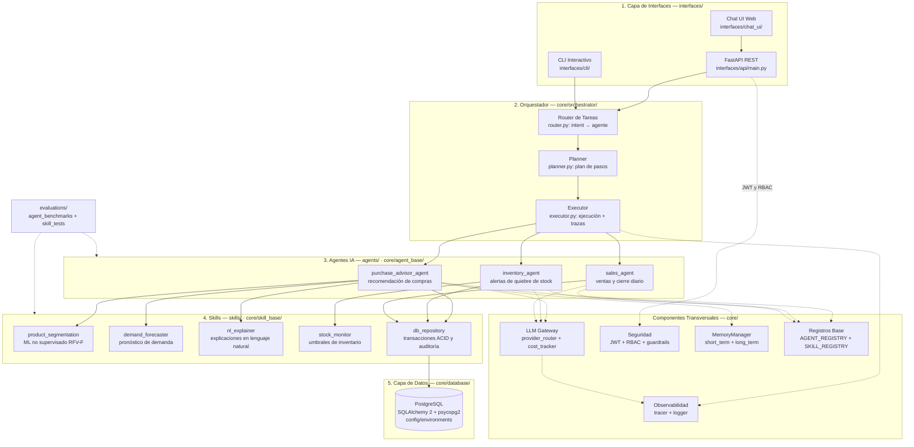

# Diagrama de Componentes — MilanFramework

> **Nota de verificación:** el código real del proyecto (`core/`, `agents/`, `skills/`, `interfaces/`, `config/`, `docs/`) corresponde a **MilanFramework**, un sistema de ventas/inventario/consumo de IA para una tienda de artículos religiosos. Los agentes descritos en el brief (arl_evaluator_agent, mintrabajo_reporter_agent, improvement_plan_agent, academic_analytics_agent) y skills como "validación de hash" o "clasificación de riesgos SST" **no existen en el código fuente actual**, por lo que no se incluyeron para no contradecir la estructura real. El motor de datos sí es **PostgreSQL**, conforme a `config/environments/{dev,prod}.yaml` (`database_url: postgresql://…`) y `psycopg2-binary` en `requirements.txt`.

## Resumen de componentes identificados

| Capa | Componentes (ruta real) |
|---|---|
| **1. Interfaces** (`interfaces/`) | FastAPI REST (`api/main.py`), CLI interactivo (`cli/`), Chat UI web (`chat_ui/`) |
| **2. Orquestador** (`core/orchestrator/`) | `router.py` (intent → agente vía `AGENT_REGISTRY`), `planner.py` (descomposición en pasos), `executor.py` (ejecución con captura de excepciones y eventos de traza) |
| **3. Agentes IA** (`agents/` + `core/agent_base/`) | `purchase_advisor_agent` (recomendación de compras), `inventory_agent` (alertas de quiebre de stock), `sales_agent` (ventas y cierre diario); todos extienden `BaseAgent` y se registran en `AGENT_REGISTRY` |
| **4. Skills determinísticas/ML** (`skills/` + `core/skill_base/`) | `product_segmentation` (ML no supervisado RFV-F), `demand_forecaster` (pronóstico cuantitativo con festividades), `nl_explainer` (NLG para no técnicos), `stock_monitor` (umbrales Agotado/Bajo/Normal), `db_repository` (persistencia ACID + auditoría de movimientos); registradas en `SKILL_REGISTRY` |
| **5. Capa de datos** (`core/database/` + `config/`) | **PostgreSQL** vía SQLAlchemy 2.x + `psycopg2-binary`; URL y entorno definidos en `config/environments/dev.yaml` y `prod.yaml` |
| **Transversales** (`core/`) | `llm_gateway/` (`provider_router.py`, `cost_tracker.py`), `security/` (`auth.py` JWT+PBKDF2, `permissions.py` RBAC Admin/Vendedor, `guardrails.py`), `memory/` (`MemoryManager`, short/long term), `observability/` (`tracer.py`, `logger.py`) |
| **Evaluación** (`evaluations/`) | `agent_benchmarks/`, `skill_tests/`, `run_tests.py` |

### Relaciones clave

- `interfaces/api` → orquestador; la API aplica **seguridad** (JWT/RBAC/guardrails) en la inyección de dependencias.
- El **executor** invoca agentes y emite eventos a **observabilidad**; los agentes consultan **LLM Gateway**, **memoria** y los **registros base**.
- `purchase_advisor_agent` orquesta `product_segmentation → demand_forecaster → nl_explainer → db_repository`; `inventory_agent` usa `stock_monitor + db_repository`; `sales_agent` usa `db_repository`.
- Único punto de persistencia: **`db_repository` → PostgreSQL** (capa `core/database/`).

## Diagrama Mermaid

- **Línea sólida**: flujo funcional principal (invocación síncrona).
- **Línea punteada**: dependencias transversales (seguridad, observabilidad, memoria, LLM, registros, evaluación).

## Archivos relacionados

- `diagrama_componentes.mmd` — fuente Mermaid independiente (previsualizable con extensión Mermaid o `mmdc`).
- `diagrama_componentes.drawio` — mismo diagrama en formato Draw.io (importable/editable).
- `.vscode/extensions.json` — recomendación de extensión para previsualizar Mermaid en el preview de Markdown de VS Code.
