# Diagrama de Clases — Core y Agentes GovSST Lab

> **Nota:** diseño objetivo anclado a los contratos reales del repositorio: `BaseAgent.run(task) -> dict` y `@register_agent` (`core/agent_base/base_agent.py`), `BaseSkill.run(params) -> dict` (`core/skill_base/base_skill.py`), `LLMGateway` (`core/llm_gateway/`), `Tracer` (`core/observability/tracer.py`), `DatabaseManager` sobre PostgreSQL (`core/database/` + `config/environments/*.yaml`). Los agentes GovSST aún no existen en el código.

## Bloque Mermaid

```mermaid
classDiagram
    class BaseAgent {
        <<abstract>>
        +str name
        +run(task: dict) : dict
    }
    class BaseSkill {
        <<abstract>>
        +str name
        +run(params: dict) : dict
    }
    class ARLEvaluatorAgent {
        +str name = "arl_evaluator_agent"
        +run(task: dict) : dict
        -evaluar_estandares(items: list) : list
        -calcular_puntaje(respuestas: dict) : decimal
    }
    class MinTrabajoReporterAgent {
        +str name = "mintrabajo_reporter_agent"
        +run(task: dict) : dict
        -generar_reporte(autoeval: Autoevaluacion) : dict
        -radicar_en_mintrabajo(payload: dict) : dict
    }
    class ImprovementPlanAgent {
        +str name = "improvement_plan_agent"
        +run(task: dict) : dict
        -crear_plan(autoeval: Autoevaluacion) : PlanMejoramiento
        -asignar_acciones(plan: PlanMejoramiento) : list
    }
    class AcademicAnalyticsAgent {
        +str name = "academic_analytics_agent"
        +run(task: dict) : dict
        -registrar_evento(evento: EventoAnalitica) : void
        -calcular_tasas_error(sesion_id: UUID) : dict
    }
    class HashValidationSkill {
        +str name = "hash_validator"
        +calcular_sha256(archivo: bytes) : str
        +verificar_hash(evidencia: Evidencia, hash: str) : bool
    }
    class RiskClassifierSkill {
        +str name = "risk_classifier"
        +clasificar_por_salario(nivel: NivelRiesgo, uvt: decimal) : str
        +aplicar_resolucion_0312(datos: dict) : dict
    }
    class StandardsScoringSkill {
        +str name = "standards_scorer"
        +puntuar_items(items: list) : decimal
        +validar_cumplimiento(item: AutoevaluacionItem) : bool
    }
    class DatabaseManager {
        -Engine engine
        -session_factory
        +get_session() : Session
        +commit() : void
        +rollback() : void
        +persistir(entidad: object) : void
    }
    class LLMGateway {
        -provider_router
        -cost_tracker
        +generar(prompt: str, contexto: dict) : str
        +registrar_costo(tokens: int) : void
    }
    class Tracer {
        +trace(evento: str, payload: dict) : void
    }
    class Usuario {
        +UUID id
        +str email
        +str rol
    }
    class Empresa {
        +UUID id
        +str nit
        +str razon_social
    }
    class NivelRiesgo {
        +int id
        +char letra
    }
    class Autoevaluacion {
        +UUID id
        +decimal puntaje_total
        +str estado
    }
    class PlanMejoramiento {
        +UUID id
        +str estado
        +date fecha_limite
    }
    class EventoAnalitica {
        +UUID id
        +int duracion_ms
        +bool exito
    }

    BaseAgent <|-- ARLEvaluatorAgent : hereda
    BaseAgent <|-- MinTrabajoReporterAgent : hereda
    BaseAgent <|-- ImprovementPlanAgent : hereda
    BaseAgent <|-- AcademicAnalyticsAgent : hereda
    BaseSkill <|-- HashValidationSkill : hereda
    BaseSkill <|-- RiskClassifierSkill : hereda
    BaseSkill <|-- StandardsScoringSkill : hereda

    ARLEvaluatorAgent ..> HashValidationSkill : usa
    ARLEvaluatorAgent ..> StandardsScoringSkill : usa
    ARLEvaluatorAgent ..> RiskClassifierSkill : usa
    ARLEvaluatorAgent --> DatabaseManager : persiste via
    MinTrabajoReporterAgent --> DatabaseManager : persiste via
    ImprovementPlanAgent --> DatabaseManager : persiste via
    AcademicAnalyticsAgent --> DatabaseManager : persiste via
    ARLEvaluatorAgent --> LLMGateway : invoca
    MinTrabajoReporterAgent --> LLMGateway : invoca
    AcademicAnalyticsAgent --> Tracer : emite eventos
    ARLEvaluatorAgent --> Autoevaluacion : produce
    ARLEvaluatorAgent --> NivelRiesgo : clasifica con
    MinTrabajoReporterAgent --> Empresa : reporta sobre
    ImprovementPlanAgent --> PlanMejoramiento : genera
    AcademicAnalyticsAgent --> EventoAnalitica : registra
    DatabaseManager --> Usuario : administra
```

## Decisiones de modelado

- **Herencia real**: los cuatro agentes GovSST heredan de `BaseAgent`; las skills (`hash_validator`, `risk_classifier`, `standards_scorer`) heredan de `BaseSkill` y se resuelven vía `SKILL_REGISTRY`, igual que los agentes existentes.
- **Dependencias (`..>`)**: los agentes componen skills determinísticas en lugar de embebir lógica de dominio (mismo patrón de `purchase_advisor_agent`).
- **`DatabaseManager`**: sesión SQLAlchemy sobre PostgreSQL con `commit`/`rollback` explícitos (operaciones atómicas de autoevaluación).
- **`LLMGateway`**: `provider_router` + `cost_tracker` reales; lo invocan los agentes que redactan reportes/explicaciones y registran costo por tokens.
- **`Tracer`**: `AcademicAnalyticsAgent` emite eventos de traza y persiste en `EVENTO_ANALITICA`.

## Archivos relacionados

- `govsst_diagrama_clases.mmd` — fuente Mermaid.
- `govsst_diagrama_clases.drawio` — Draw.io del diagrama de clases (herencia, dependencias y asociaciones).
