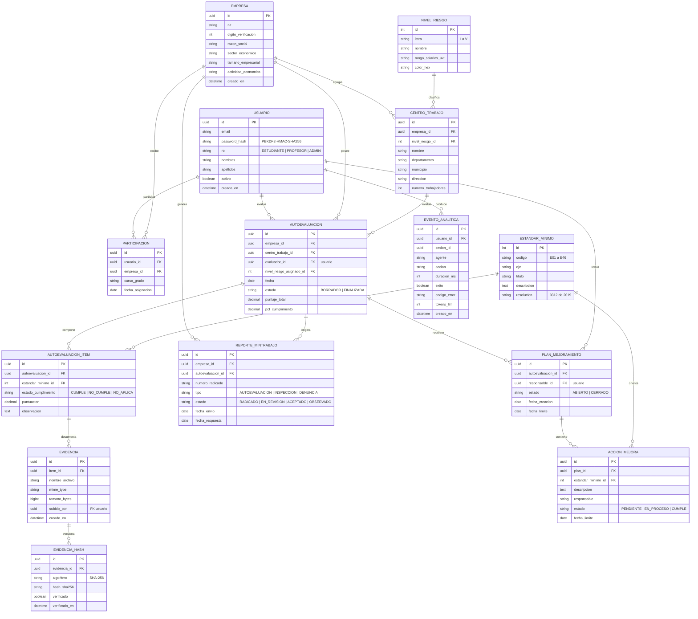

# Diagrama Entidad-Relación — GovSST Lab (PostgreSQL)

> **Nota:** diseño objetivo de la capa de persistencia. El repositorio actual contiene el framework base real (MilanFramework: `core/agent_base`, `core/skill_base`, `core/llm_gateway`, `core/observability`) y PostgreSQL configurado en `config/environments/*.yaml` con `psycopg2-binary`. Las entidades GovSST / Resolución 0312 se modelan aquí por primera vez.

## Bloque Mermaid

## Decisiones de modelado

- **Cardinalidades 1:N**: `EMPRESA → CENTRO_TRABAJO`, `EMPRESA → AUTOEVALUACION`, `AUTOEVALUACION → AUTOEVALUACION_ITEM`, `AUTOEVALUACION_ITEM → EVIDENCIA`, `EVIDENCIA → EVIDENCIA_HASH` (hash versionado), `PLAN_MEJORAMIENTO → ACCION_MEJORA`, `USUARIO → EVENTO_ANALITICA`.
- **Cardinalidad N:M (resuelta)**: `USUARIO ↔ EMPRESA` mediante `PARTICIPACION` (un estudiante evalúa varias empresas; una empresa recibe muchos estudiantes).
- **Catálogos**: `NIVEL_RIESGO` (I–V con rango salarial en UVT) y `ESTANDAR_MINIMO` (E01–E46, Resolución 0312 de 2019).
- **Integridad de evidencias**: `EVIDENCIA_HASH` guarda SHA-256 por evidencia para verificación posterior (`hash_validator`) sin perder historial.
- **Analítica educativa**: `EVENTO_ANALITICA` registra `duracion_ms`, `exito`, `codigo_error` y `tokens_llm` por sesión → tasas de error y tiempos.
- **Seguridad**: `password_hash` con PBKDF2-HMAC-SHA256 (consistente con `core/security/auth.py`).

## Archivos relacionados

- `govsst_diagrama_er.mmd` — fuente Mermaid.
- `govsst_diagrama_er.drawio` — Draw.io del DER (13 tablas PK/FK, relaciones crow's foot).
