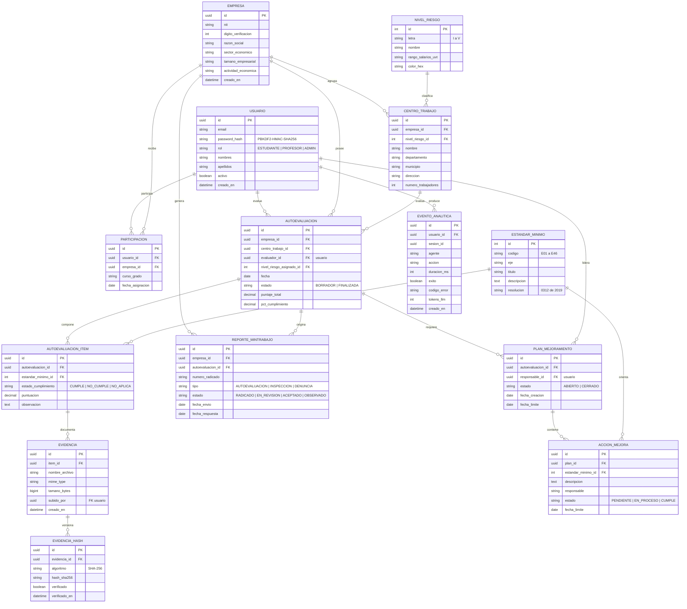

# Modelo de Datos y Diagrama de Clases — GovSST Lab (diseño objetivo)

> **Nota de procedencia (importante):** el repositorio actual contiene el framework base real (**MilanFramework**): contratos verificados en `core/agent_base/base_agent.py` (`BaseAgent.run(task) -> dict`, `@register_agent`), `core/skill_base/base_skill.py` (`BaseSkill.run(params) -> dict`), `core/llm_gateway/` (`provider_router.py`, `cost_tracker.py`), `core/database/` (módulo de persistencia, hoy vacío más allá del docstring), `core/observability/` (`tracer.py`, `logger.py`) y PostgreSQL como motor configurado (`config/environments/*.yaml`, `psycopg2-binary`).
>
> Las entidades de dominio GovSST (Resolución 0312 de 2019, ARL SURA, MinTrabajo, analítica educativa) **no existen aún en el código**; los diagramas de este documento son el **diseño objetivo** de la capa de persistencia y de las clases de dominio, alineado a los contratos reales del framework. Los agentes GovSST heredan de `BaseAgent` exactamente igual que los agentes existentes.

## Bloque 1 — Diagrama Entidad-Relación (PostgreSQL)

### Decisiones de modelado (DER)

- **Cardinalidades 1:N**: `EMPRESA → CENTRO_TRABAJO`, `EMPRESA → AUTOEVALUACION`, `AUTOEVALUACION → AUTOEVALUACION_ITEM`, `AUTOEVALUACION_ITEM → EVIDENCIA`, `EVIDENCIA → EVIDENCIA_HASH` (hash versionado: permite re-verificar sin destruir historial), `PLAN_MEJORAMIENTO → ACCION_MEJORA`, `USUARIO → EVENTO_ANALITICA`.
- **Cardinalidad N:M (resuelta)**: `USUARIO ↔ EMPRESA` a través de `PARTICIPACION` (un estudiante puede trabajar varias empresas por sesión académica; una empresa recibe muchos estudiantes).
- **Catálogos**: `NIVEL_RIESGO` (I–V, letra + rango salarial en UVT) y `ESTANDAR_MINIMO` (códigos E01–E46 de la Resolución 0312 de 2019) como tablas dimensionales reutilizables entre autoevaluaciones.
- **Integridad de evidencias**: la subida de evidencia se asocia al `AUTOEVALUACION_ITEM`; el hash SHA-256 se guarda en tabla aparte para verificación posterior por `hash_validator` (inmutabilidad de la prueba).
- **Auditoría académica**: `EVENTO_ANALITICA` guarda `duracion_ms`, `exito`, `codigo_error` y `tokens_llm` por sesión — base para tasas de error y tiempos por agente.
- **Password storage**: `password_hash` con PBKDF2-HMAC-SHA256, consistente con `core/security/auth.py` del framework.

## Bloque 2 — Diagrama de Clases (core y agentes)

```mermaid
classDiagram
    class BaseAgent {
        <<abstract>>
        +str name
        +run(task: dict) : dict
    }
    class BaseSkill {
        <<abstract>>
        +str name
        +run(params: dict) : dict
    }
    class ARLEvaluatorAgent {
        +str name = "arl_evaluator_agent"
        +run(task: dict) : dict
        -evaluar_estandares(items: list) : list
        -calcular_puntaje(respuestas: dict) : decimal
    }
    class MinTrabajoReporterAgent {
        +str name = "mintrabajo_reporter_agent"
        +run(task: dict) : dict
        -generar_reporte(autoeval: Autoevaluacion) : dict
        -radicar_en_mintrabajo(payload: dict) : dict
    }
    class ImprovementPlanAgent {
        +str name = "improvement_plan_agent"
        +run(task: dict) : dict
        -crear_plan(autoeval: Autoevaluacion) : PlanMejoramiento
        -asignar_acciones(plan: PlanMejoramiento) : list
    }
    class AcademicAnalyticsAgent {
        +str name = "academic_analytics_agent"
        +run(task: dict) : dict
        -registrar_evento(evento: EventoAnalitica) : void
        -calcular_tasas_error(sesion_id: UUID) : dict
    }
    class HashValidationSkill {
        +str name = "hash_validator"
        +calcular_sha256(archivo: bytes) : str
        +verificar_hash(evidencia: Evidencia, hash: str) : bool
    }
    class RiskClassifierSkill {
        +str name = "risk_classifier"
        +clasificar_por_salario(nivel: NivelRiesgo, uvt: decimal) : str
        +aplicar_resolucion_0312(datos: dict) : dict
    }
    class StandardsScoringSkill {
        +str name = "standards_scorer"
        +puntuar_items(items: list) : decimal
        +validar_cumplimiento(item: AutoevaluacionItem) : bool
    }
    class DatabaseManager {
        -Engine engine
        -session_factory
        +get_session() : Session
        +commit() : void
        +rollback() : void
        +persistir(entidad: object) : void
    }
    class LLMGateway {
        -provider_router
        -cost_tracker
        +generar(prompt: str, contexto: dict) : str
        +registrar_costo(tokens: int) : void
    }
    class Tracer {
        +trace(evento: str, payload: dict) : void
    }
    class Usuario {
        +UUID id
        +str email
        +str rol
    }
    class Empresa {
        +UUID id
        +str nit
        +str razon_social
    }
    class NivelRiesgo {
        +int id
        +char letra
    }
    class Autoevaluacion {
        +UUID id
        +decimal puntaje_total
        +str estado
    }
    class PlanMejoramiento {
        +UUID id
        +str estado
        +date fecha_limite
    }
    class EventoAnalitica {
        +UUID id
        +int duracion_ms
        +bool exito
    }

    BaseAgent <|-- ARLEvaluatorAgent : hereda
    BaseAgent <|-- MinTrabajoReporterAgent : hereda
    BaseAgent <|-- ImprovementPlanAgent : hereda
    BaseAgent <|-- AcademicAnalyticsAgent : hereda
    BaseSkill <|-- HashValidationSkill : hereda
    BaseSkill <|-- RiskClassifierSkill : hereda
    BaseSkill <|-- StandardsScoringSkill : hereda

    ARLEvaluatorAgent ..> HashValidationSkill : usa
    ARLEvaluatorAgent ..> StandardsScoringSkill : usa
    ARLEvaluatorAgent ..> RiskClassifierSkill : usa
    ARLEvaluatorAgent --> DatabaseManager : persiste via
    MinTrabajoReporterAgent --> DatabaseManager : persiste via
    ImprovementPlanAgent --> DatabaseManager : persiste via
    AcademicAnalyticsAgent --> DatabaseManager : persiste via
    ARLEvaluatorAgent --> LLMGateway : invoca
    MinTrabajoReporterAgent --> LLMGateway : invoca
    AcademicAnalyticsAgent --> Tracer : emite eventos
    ARLEvaluatorAgent --> Autoevaluacion : produce
    ARLEvaluatorAgent --> NivelRiesgo : clasifica con
    MinTrabajoReporterAgent --> Empresa : reporta sobre
    ImprovementPlanAgent --> PlanMejoramiento : genera
    AcademicAnalyticsAgent --> EventoAnalitica : registra
    DatabaseManager --> Usuario : administra
```

### Decisiones de modelado (clases)

- **Herencia real**: los cuatro agentes GovSST heredan de `BaseAgent` (contrato verificado en `core/agent_base/base_agent.py`: `run(task: dict) -> dict` + registro con `@register_agent`); las skills heredan de `BaseSkill` y se resuelven vía `SKILL_REGISTRY`, igual que `purchase_advisor_agent`.
- **Agregación/dependencia** (`..>`): los agentes usan skills determinísticas (`hash_validator`, `risk_classifier`, `standards_scorer`) en vez de implementar lógica de dominio embebida — mismo patrón de composición del agente real de compras.
- **`DatabaseManager`** (implementación de `core/database/`): sesión SQLAlchemy sobre PostgreSQL (`database_url` de `config/environments/`), con `commit`/`rollback` explícitos para las operaciones atómicas de autoevaluación (análogo al RNF05 actual de transaccionalidad).
- **`LLMGateway`** existe en el repo (`core/llm_gateway/provider_router.py` + `cost_tracker.py`); los agentes que necesiten redacción de reportes o explicaciones lo invocan y registran costo por tokens.
- **`Tracer`** existe en `core/observability/tracer.py`; `AcademicAnalyticsAgent` emite eventos de traza y además persiste en `EVENTO_ANALITICA`.

## Archivos relacionados

- `govsst_diagrama_er.mmd` — fuente Mermaid del DER.
- `govsst_diagrama_clases.mmd` — fuente Mermaid del diagrama de clases.
- `govsst_modelo_datos.drawio` — Draw.io con **2 páginas**: "DER GovSST Lab" (13 tablas con PK/FK y relaciones crow's foot) y "Diagrama de Clases".
